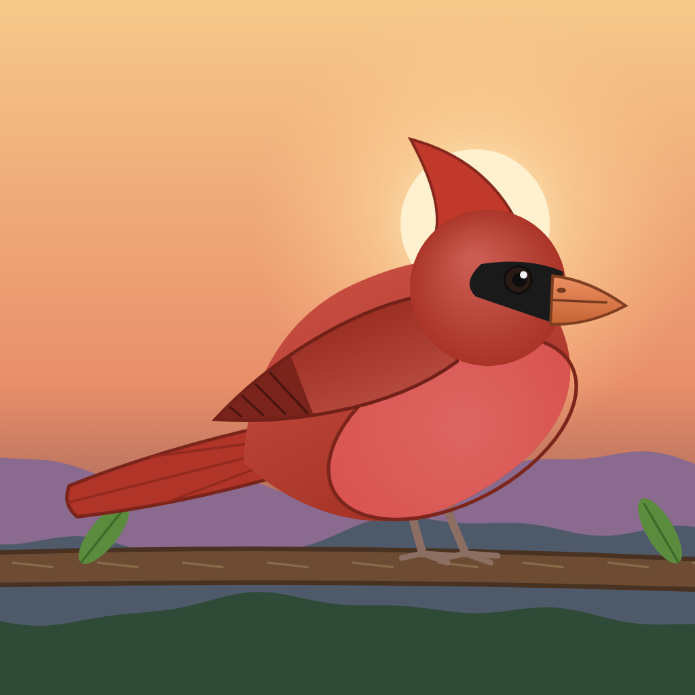
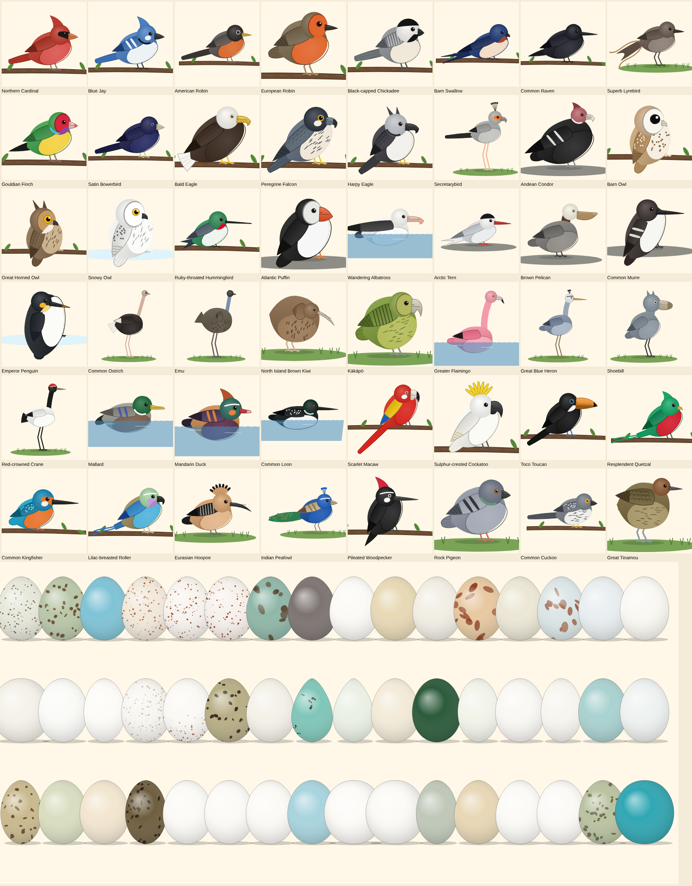

# 🪶 Plumage: A Living Atlas of Birds

Plumage is a game-like bird encyclopedia for iPhone and iPad, built in SwiftUI. You explore 48 species
in a naturalist's field journal, hear their songs over ambient forest, brook and shore soundscapes,
reshape and repaint any bird in a studio, hatch mystery eggs, and earn feathers, XP and achievements
through quizzes and mini-games.

Every bird, egg, map and sound is generated procedurally, so the app needs no image or audio assets.

<p align="center"></p>



*Above: output of the procedural renderer for all 48 species and their eggs. This is a renderer preview,
not an app screenshot.*

---

## Features

### 📚 The Atlas (encyclopedia)
- **48 species** across 13 groups: songbirds, raptors, owls, seabirds, flightless birds, waders, waterfowl,
  parrots, tropical birds, hummingbirds, ground birds, woodpeckers and other notable birds.
- Search across names, Latin names, habitats, regions and diet. Filter by group, region, habitat, diet,
  favourites, undiscovered or threatened species. Sort by size, wingspan, weight, rarity or IUCN status.
  Switch between a grid and a list.
- Undiscovered birds appear as **silhouettes** until you open them.

### 🪶 Species detail pages
- **Hero illustration**: an animated bird that breathes, blinks and bobs its head. Tap it to make it sing
  and flap its wings.
- **Overview**: summary, field measurements (length, wingspan, weight, lifespan, top speed, population),
  a taxonomy ladder from class to species, the IUCN conservation scale, trait bars (flight, song, smarts,
  stealth, social), and curious facts.
- **Anatomy**: a plumage palette with colour names and hex codes, a close-up of the bill and what it is
  built for, distinctive features, and a to-scale silhouette next to a 170 cm person.
- **Behaviour**: signature behaviours, diet chips with notes, and a migration meter.
- **Eggs & Nest**:
  - egg **colour, shape class** (spherical, elliptical, long elliptical, oval, pyriform, conical,
    biconical) and **markings** (plain, speckled, spotted, blotched, scrawled, capped, streaked)
  - true size next to a hen's egg, dimensions and volume
  - clutch size, a typical clutch drawn as a row of eggs, and an incubation timeline
  - nest type and description
- **Song**: a play button, a mnemonic, the call description, and a **sonogram** drawn from the notes
  being played, with a moving playhead.
- **Range**: a hand-drawn world map with highlighted regions and animated pins, plus a list of habitats.
- **Field Notes**: your own notes on lined paper, in a handwriting font, saved automatically.

### 🎨 Bird Studio
- Recolour every part of the bird with colour pickers: crown, neck, back, breast, wing coverts,
  flight feathers, tail, crest, bill, bill tip, iris, legs, and the eyespots on trains and lyre tails.
- Reshape the bird:
  - choose from **13 bill types**, **7 crests** and **8 tails** (including a peacock train, a lyrebird
    lyre and quetzal streamers)
  - adjust sliders for bill length and angle, crest size, tail length and angle, plumpness, posture,
    neck, legs, head, eyes and wing length
- **Markings**: wing patterns (bars, spots, scallops, stripes), breast patterns, and toggles for
  mask, bib, cheek, cap, brow stripe, facial disc, eye ring and collar, each with its own colour.
- **Magic palettes** apply leucistic, melanistic, sunset, frost, ember, aurora, midnight or golden colouring.
  Some are unlocked with feathers.
- Other tools: undo, a "Mutate" randomiser, reset, and a choice of scene (branch, meadow, water,
  ice floe, rock).
- **Apply to Atlas** shows your design everywhere that species appears. **Frame & save** creates a museum
  "plate" you can save to your Journal or share as an image.

### 🎮 Games
- **Birder's Quiz** has 5 modes: *Whose Egg?*, *Name That Song*, *Shadow Birds* (silhouettes),
  *Field Clues*, and a mixed *Grand Tour*. Each round has 8 timed questions with streak bonuses and an
  explanation after every answer.
- **The Hatchery**: pick a mystery egg and keep it warm by tapping. Stay inside the thermometer's green
  zone to make progress; overheating stops it. Cracks appear as it develops, and you can guess the
  species for bonus feathers.
  - Hatchlings are unique individuals with small colour variations. Some are rare variants:
    leucistic, melanistic, aurora or golden.
  - You can name a hatchling and make it your companion on the home screen.
- **Nest Match**: a memory card game where you pair each bird with its own egg. It has 4, 6 or 8 pairs.
- **Egg Lab**: shape an egg with sliders, see which shape class it belongs to, and find the real species
  whose egg is closest. The **Egg Gallery** shows every egg at true relative size.

### 🏆 Progression
- XP and **15 levels**, from *Egg* to *Grand Aviarist*, with a level-up celebration.
- **Feathers** are the currency. You earn them from discoveries, quizzes, hatching and a daily gift,
  and spend them on Studio palettes.
- **23 achievements** (Night Watch, Raptor Ranger, Oologist, Flawless, Shiny!, Globetrotter and more).
- A **Bird of the Day**, a daily gift with a streak bonus, and visit streaks.
- A **Journal** with your profile, stats, collection progress by group, achievements, aviary, creations
  and favourites.

### 🔊 Sound, made on the device
- **Birdsong synthesis** (`BirdSynth`) builds each species' song from short notes. There are 23 call
  styles, including whistles, trills, warbles, hoots, coos, caws, croaks, quacks, woodpecker drumming,
  screeches, honks, booms, loon yodels, shoebill bill-clatter, lyrebird mimicry and the cuckoo's two notes.
  - Notes are shaped with harmonics, frequency sweeps, vibrato, amplitude trills and band-passed noise.
  - The same species always sings the same song.
- **Six looping soundscapes** (`AmbientSynth`): Forest Breeze, Babbling Brook (hundreds of tiny
  resonant bubbles), Summer Meadow (grasshoppers), Moonlit Night (crickets), Gentle Rain and
  Ocean Shore (breaking surf). Each loop is crossfaded so it repeats without a click.
- A **distant chorus**: species that match the current soundscape call occasionally from random
  directions through a reverb. At night it switches to owls and other nocturnal birds.
- Interface chimes, haptics, and a mixing setup that respects the silent switch.
- **Real recordings**: add files named `<species-id>.m4a` (or `.mp3`, `.wav`, `.caf`) to the app target,
  e.g. `barn-owl.m4a`, and they are played instead of the synthesized song.

### 🌄 Look & feel
- A **living backdrop** behind every screen. Depending on the time of day (or your choice in Settings)
  it shows a dawn, day, dusk or night sky:
  - drifting clouds, layered hills with pines and passing flocks
  - falling leaves by day, and stars, a crescent moon and fireflies at night
- Artistic fonts that ship with iOS, so none are bundled: *Snell Roundhand* for titles, *Didot* headings,
  *Copperplate* labels, *Baskerville* body text, *Noteworthy* for handwritten notes and
  *American Typewriter* for data.
- Parchment cards with paper grain, gold dashed borders and fleuron ornaments (❦).
- VoiceOver labels throughout, and support for Reduce Motion.

---

## Getting started

**Requirements:** Xcode 16 or newer, with iOS 17 or later on a device or the Simulator.

1. Open `Plumage.xcodeproj` in Xcode.
2. Select the **Plumage** scheme and an iPhone simulator.
3. Press **Run** (⌘R).

To run on a physical device, set your Team under *Signing & Capabilities*. You may also need a unique
bundle identifier.

The project uses Xcode 16 *synchronized folders*, so any file you add under `Plumage/` is picked up
automatically. If you prefer XcodeGen, a `project.yml` is included: `brew install xcodegen && xcodegen`.

---

## Project layout

```
Plumage/
├── App/                  PlumageApp, RootView (tabs, splash, overlays), AppRouter
├── Models/               BirdSpecies & vocabularies, BirdAppearance, RGBA, BirdDatabase,
│                         GameModels (save data, levels, hatchlings), Achievements & palettes
├── Services/             GameState (progress + persistence), SoundEngine, BirdSynth,
│                         AmbientSynth, Haptics
├── Rendering/            BirdRenderer + BirdView (procedural birds), EggView, WorldMapView,
│                         NatureBackdrop
├── Theme/                Palette, fonts, parchment cards, button styles
├── Components/           Headers, chips, stat bars, flow layout, waveform, feather bursts, toasts
├── Views/
│   ├── Home/             Nest (home), onboarding
│   ├── Atlas/            Encyclopedia, filters, Side-by-Side compare
│   ├── Detail/           Species page + Overview/Anatomy/Behaviour/Eggs/Song/Range/Notes
│   ├── Studio/           Bird Studio, framing & sharing
│   ├── Games/            Games hub, Quiz, Hatchery & Aviary, Nest Match, Egg Lab
│   └── Journal/          Journal, achievements, settings
└── Resources/
    ├── birds.json        The species database
    └── Assets.xcassets   App icon & accent colour
Tools/validate_birds.py   Checks birds.json against the Swift enums
```

## Adding or editing species

All species data is in `Plumage/Resources/birds.json`. Each entry includes:

- taxonomy, summary, IUCN status, regions, habitats and diet
- measurements, as `[min, max]` ranges
- traits, behaviours, and the call with its `song` synthesis signature
- nest, egg (shape, pattern, colours, size, clutch, incubation) and facts
- an `appearance` block for the renderer

Appearance keys are optional. Missing colours inherit sensible defaults: the neck takes the head colour,
the tail takes the wing colour, and so on.

After editing, run the validator:

```bash
python3 Tools/validate_birds.py
```

It checks every field and enum value against the Swift source, so a typo can't crash the app at launch.

## Notes on accuracy

Facts and measurements come from widely published ornithological references (IUCN Red List
categories, field guides). They are typical adult ranges and vary across populations and sexes.
Illustrations and songs are stylised, procedural interpretations rather than recordings or photographs.
